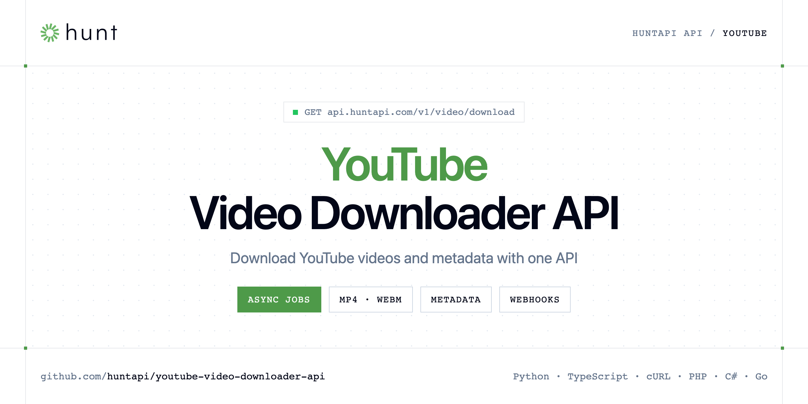

<p align="center">
  <a href="https://www.huntapi.com"></a>
</p>

# YouTube Video Downloader API

[](https://discord.gg/CFj3ph8aHU) [](https://app.huntapi.com/register) [](https://docs.huntapi.com) [](LICENSE)

Download YouTube videos programmatically with **HuntAPI**: submit a YouTube URL, poll the job, get a link to the file. Fetch the video metadata (title, duration, thumbnail, views) in a single call.

- **YouTube Video Download API** — 
- **YouTube Metadata API** — Extract metadata from a media URL without downloading the file.

Use it for archiving, AI/transcription pipelines, editing workflows or no-code automations (n8n, Make).

| Endpoint | Request | Credits |
|---|---|---|
| [YouTube Video Download API](#youtube-video-download-api) | `GET /v1/video/download` | 1 |
| [YouTube Metadata API](#youtube-metadata-api) | `GET /v1/media/metadata` | 1 |

## Table of contents

- [How it works](#how-it-works)
- [YouTube Video Download API](#youtube-video-download-api)
- [YouTube Metadata API](#youtube-metadata-api)
- [Code examples in other languages](#code-examples-in-other-languages)
- [Use cases](#use-cases)
- [Why HuntAPI?](#why-huntapi)
- [FAQ](#faq)
- [Official SDKs](#official-sdks)
- [Related repositories](#related-repositories)
- [Support](#support)

## How it works

1. **Create a HuntAPI account** and copy your API key from the [dashboard](https://app.huntapi.com/register).
2. **Call `https://api.huntapi.com`** with the header `x-api-key: YOUR_API_KEY`.
3. **Use the result** in your app — no infrastructure to run.

```bash
export HUNTAPI_API_KEY="your-api-key"
pip install requests        # Python
# TypeScript: Node.js 18+ (native fetch), run with `npx tsx file.ts`
```

## YouTube Video Download API


`GET https://api.huntapi.com/v1/video/download` · **1 credit per request** · [API reference](https://app.huntapi.com/openapi)

### Request parameters

| Parameter | In | Type | Required | Description |
|---|---|---|---|---|
| `query` | query | string | ✅ | Video URL to download. |
| `download_type` | query | string | — | Desired download type. You have three options: |
| `max_duration` | query | number | — | Maximum duration of the downloaded content in seconds. If the video/audio is longer than this value, only the content up to this duration will be downloaded. |
| `video_quality` | query | string | — | Desired video quality. Available options: |
| `video_format` | query | string | — | Desired output format for the video. Available options: |
| `webhook_url` | query | string | — | URL of the webhook where results will be sent. When specified, the system will attempt to send the response to this URL up to 3 times with a 5-second delay between each attempt. The results will be sent as a POST request… |
| `webhook_authorization` | query | string | — | Authorization header for the webhook. This parameter allows you to add authentication to your webhook endpoint. This value will be included in the `Authorization` header when making the webhook request to your server. |

### Python example

```python
import os
import time

import requests

API_KEY = os.environ["HUNTAPI_API_KEY"]
HEADERS = {"x-api-key": API_KEY}

response = requests.get(
    "https://api.huntapi.com/v1/video/download",
    headers=HEADERS,
    params={
        "query": "https://www.youtube.com/watch?v=Z5YP8kznWZs",
        "video_quality": "720p",
        "video_format": "mp4",
    },
    timeout=120,
)
response.raise_for_status()

job_id = response.json()["job_id"]

# Poll the job until it reaches a final status (give up after 12 hours)
for _ in range(4320):
    time.sleep(10)
    poll = requests.get(f"https://api.huntapi.com/v1/jobs/{job_id}", headers=HEADERS, timeout=120)
    poll.raise_for_status()
    job = poll.json()
    print(job["status"], job.get("progress"))
    if job["status"] in ("CompletedJob", "Error", "NotFound", "BadRequest"):
        break
else:
    raise SystemExit(f"Job {job_id} still running after 12 hours")

if job["status"] != "CompletedJob":
    raise SystemExit("Job failed: " + job["status"])
print(job.get("result"))
```

### TypeScript example

```typescript
const headers = { "x-api-key": process.env.HUNTAPI_API_KEY!, "Content-Type": "application/json" };

const params = new URLSearchParams({
  "query": "https://www.youtube.com/watch?v=Z5YP8kznWZs",
  "video_quality": "720p",
  "video_format": "mp4",
});

const response = await fetch(`https://api.huntapi.com/v1/video/download?${params}`, { headers });
if (!response.ok) throw new Error(`HTTP ${response.status}: ${await response.text()}`);

const { job_id: jobId } = (await response.json()) as { job_id: string };

type Job = { status: string; progress?: number; result?: unknown };
const done = new Set(["CompletedJob", "Error", "NotFound", "BadRequest"]);
let job: Job | undefined;
for (let i = 0; i < 4320; i++) { // give up after 12 hours
  await new Promise((r) => setTimeout(r, 10000));
  const poll = await fetch(`https://api.huntapi.com/v1/jobs/${jobId}`, { headers });
  if (!poll.ok) throw new Error(`HTTP ${poll.status}: ${await poll.text()}`);
  job = (await poll.json()) as Job;
  console.log(job.status, job.progress);
  if (done.has(job.status)) break;
}
if (job?.status !== "CompletedJob") throw new Error(`Job ${jobId} not completed: ${job?.status}`);

console.log(job.result);
```

### Async workflow

1. The request returns `{"job_id": "…"}` immediately.
2. Poll `GET https://api.huntapi.com/v1/jobs/{id}` every few seconds — `status` goes from `Queued` to `Running` (with `progress` 0–100) to a final value: `CompletedJob`, `Error`, `NotFound`, `BadRequest`.
3. When `status` is `CompletedJob`, read `result` (download link and metadata).

Jobs on very long videos can take up to 12 hours before they time out: the examples poll every 10 seconds and give up after 12 hours.

Prefer push over polling? Pass `webhook_url` and the result is POSTed to your endpoint.

## YouTube Metadata API

Extract metadata from a media URL without downloading the file.

`GET https://api.huntapi.com/v1/media/metadata` · **1 credit per request** · [API reference](https://app.huntapi.com/openapi)

### Request parameters

| Parameter | In | Type | Required | Description |
|---|---|---|---|---|
| `query` | query | string | ✅ | Media URL to inspect (YouTube, Instagram, TikTok, Vimeo, X, Facebook, Twitch, Reddit, etc.). |

### Python example

```python
import os

import requests

API_KEY = os.environ["HUNTAPI_API_KEY"]
HEADERS = {"x-api-key": API_KEY}

response = requests.get(
    "https://api.huntapi.com/v1/media/metadata",
    headers=HEADERS,
    params={
        "query": "https://www.youtube.com/watch?v=Z5YP8kznWZs",
    },
    timeout=120,
)
response.raise_for_status()

data = response.json()
print(data)
```

### TypeScript example

```typescript
type YoutubeMetadataApi = {
  metadata?: {
    id?: string;
    ext?: string;
    title?: string;
    width?: number;
    height?: number;
    channel?: string;
    is_live?: boolean;
    duration?: number;
    was_live?: boolean;
    extractor?: string;
    thumbnail?: string;
    like_count?: number;
    view_count?: number;
    channel_url?: string;
    description?: string;
    live_status?: string;
    upload_date?: number;
    webpage_url?: string;
    original_url?: string;
  };
};

const headers = { "x-api-key": process.env.HUNTAPI_API_KEY!, "Content-Type": "application/json" };

const params = new URLSearchParams({
  "query": "https://www.youtube.com/watch?v=Z5YP8kznWZs",
});

const response = await fetch(`https://api.huntapi.com/v1/media/metadata?${params}`, { headers });
if (!response.ok) throw new Error(`HTTP ${response.status}: ${await response.text()}`);

const data = (await response.json()) as YoutubeMetadataApi;
console.log(data);
```

### Output example

Example response from the API reference, abridged.

```json
{
  "metadata": {
    "id": "3g3Eow41B6I",
    "ext": "mp4",
    "title": "Faire une interview Multicam avec UNE SEULE caméra",
    "width": 640,
    "height": 360,
    "channel": "Alex Jackson",
    "is_live": false,
    "duration": 432,
    "was_live": false,
    "extractor": "Youtube",
    "thumbnail": "https://i.ytimg.com/vi/3g3Eow41B6I/maxresdefault.jpg",
    "like_count": 4060,
    "view_count": 93297,
    "channel_url": "https://www.youtube.com/channel/UCW0GdGxlRENND_ft84Cp5vg",
    "description": "🎁 Starter Pack DaVinci Resolve GRATUIT : https://formations.alexjackson.io/starter-pack-davinci-resolve",
    "live_status": "not_live",
    "upload_date": 1712188800,
    "webpage_url": "https://www.youtube.com/watch?v=3g3Eow41B6I",
    "original_url": "https://www.youtube.com/watch?v=3g3Eow41B6I"
  }
}
```

### Response fields

| Field | Type | Description |
|---|---|---|
| `metadata` | object |  |
| `metadata.id` | string |  |
| `metadata.ext` | string |  |
| `metadata.title` | string |  |
| `metadata.width` | integer |  |
| `metadata.height` | integer |  |
| `metadata.channel` | string |  |
| `metadata.is_live` | boolean |  |
| `metadata.duration` | integer |  |
| `metadata.was_live` | boolean |  |
| `metadata.extractor` | string |  |
| `metadata.thumbnail` | string |  |
| `metadata.like_count` | integer |  |
| `metadata.view_count` | integer |  |
| `metadata.channel_url` | string |  |
| `metadata.description` | string |  |
| `metadata.live_status` | string |  |
| `metadata.upload_date` | integer |  |
| `metadata.webpage_url` | string |  |
| `metadata.original_url` | string |  |

## Code examples in other languages

Ready-to-run examples live in [`examples/`](examples); each reads your key from `HUNTAPI_API_KEY`.

| Language | `video-download` | `media-metadata` |
|---|---|---|
| cURL (Bash) | [video_download.sh](examples/curl/video_download.sh) | [media_metadata.sh](examples/curl/media_metadata.sh) |
| PHP | [video_download.php](examples/php/video_download.php) | [media_metadata.php](examples/php/media_metadata.php) |
| C# | [VideoDownload.cs](examples/csharp/VideoDownload.cs) | [MediaMetadata.cs](examples/csharp/MediaMetadata.cs) |
| Go | [video_download.go](examples/go/video_download.go) | [media_metadata.go](examples/go/media_metadata.go) |
| Java | [VideoDownloadExample.java](examples/java/VideoDownloadExample.java) | [MediaMetadataExample.java](examples/java/MediaMetadataExample.java) |
| Ruby | [video_download.rb](examples/ruby/video_download.rb) | [media_metadata.rb](examples/ruby/media_metadata.rb) |
| Node.js | [video_download.mjs](examples/nodejs/video_download.mjs) | [media_metadata.mjs](examples/nodejs/media_metadata.mjs) |

## Use cases

- **AI pipelines** — Download then transcribe or analyse videos.
- **Archiving** — Keep copies of videos you own or are allowed to store.
- **Automation** — Trigger downloads from n8n, Make, Zapier or your backend.

## Why HuntAPI?

- **Async by design** — submit a URL, get a `job_id`, follow `progress` (0–100) or receive a webhook.
- **Video & audio** — choose quality (up to `1080p` / `best`) and format (`mp4`, `webm`, `mkv`, `mp3`, `m4a`, `wav`).
- **Metadata in one call** — title, duration, thumbnail, channel and view counts without downloading the file.
- **One API key, one header** — `x-api-key` on every request, JSON everywhere.
- **Copy-paste examples** — Python and TypeScript in each README, 7 more languages in `examples/`.

## FAQ

### How do I authenticate?

Create an account on [HuntAPI](https://app.huntapi.com/register), copy your API key and send it in the `x-api-key` header of every request to `https://api.huntapi.com`.

### How much does a request cost?

Credits per call: `/v1/video/download` **1**, `/v1/media/metadata` **1**. See [HuntAPI pricing](https://www.huntapi.com/pricing).

### Why is the response a job id?

Downloads run asynchronously. The request returns a `job_id`; poll `GET /v1/jobs/{id}` until `status` is one of `CompletedJob`, `Error`, `NotFound`, `BadRequest`, or pass `webhook_url` to be notified.

### Can I receive results by webhook?

Yes. Set `webhook_url` (and optionally `webhook_authorization`) and the result is POSTed to your endpoint.

### Is it legal to download YouTube videos?

Only download content you own or have the right to use, and respect YouTube's terms and copyright law. This is not legal advice.

### Which videos cannot be downloaded?

Private, deleted/unavailable and age-restricted videos return an explanatory error message.

### Which languages are supported?

Any language that can make an HTTP request. This README shows Python and TypeScript; the [`examples/`](examples) folder contains cURL, PHP, C#, Go, Java, Ruby and Node.js.

## Official SDKs

Use HuntAPI from your own language with a typed client:

| SDK | Package | Install |
| --- | --- | --- |
| Node.js | [`@huntapi/sdk`](https://www.npmjs.com/package/@huntapi/sdk) | `npm install @huntapi/sdk` |
| Python | [`huntapi`](https://pypi.org/project/huntapi/) | `pip install huntapi` |
| Go | [`huntapi-go`](https://pkg.go.dev/github.com/huntapi/huntapi-go) | `go get github.com/huntapi/huntapi-go` |
| .NET | [`HuntApi`](https://www.nuget.org/packages/HuntApi) | `dotnet add package HuntApi` |
| Ruby | [`huntapi`](https://rubygems.org/gems/huntapi) | `gem install huntapi` |
| PHP | [`huntapi/sdk`](https://packagist.org/packages/huntapi/sdk) | `composer require huntapi/sdk` |
| Java | [`huntapi-java`](https://github.com/huntapi/huntapi-java) | build from source, see its README |
| CLI | [`@huntapi/cli`](https://www.npmjs.com/package/@huntapi/cli) | `npm install -g @huntapi/cli` |
| MCP server | [`@huntapi/mcp`](https://www.npmjs.com/package/@huntapi/mcp) | `npx -y @huntapi/mcp` |

## Related repositories

- [Video Download API](https://github.com/huntapi/video-download-api)
- [Audio Download API](https://github.com/huntapi/audio-download-api)
- [Media Metadata API](https://github.com/huntapi/media-metadata-api)
- [YouTube to MP3 API](https://github.com/huntapi/youtube-to-mp3-api)
- [All HuntAPI repositories](https://github.com/huntapi)

## Support

- 💬 Join the [Discord](https://discord.gg/CFj3ph8aHU) to ask questions and share what you build.
- 📚 Read the [API reference](https://docs.huntapi.com).
- 🔑 [Get your API key](https://app.huntapi.com/register).

---

<p align="center">
  <a href="https://www.huntapi.com">
    <picture>
      <source media="(prefers-color-scheme: dark)" srcset="images/logo-dark.svg">
      
    </picture>
  </a>
  <br>
  <sub>Built by <a href="https://www.huntapi.com">HuntAPI</a>. Examples are released under the MIT license.</sub>
</p>
